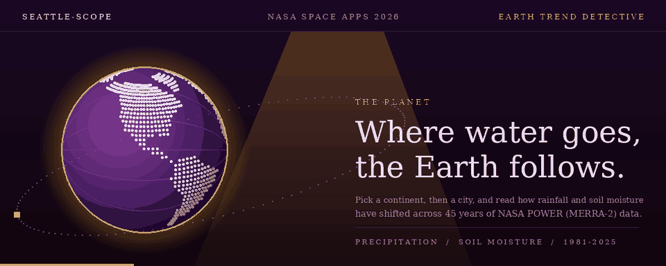
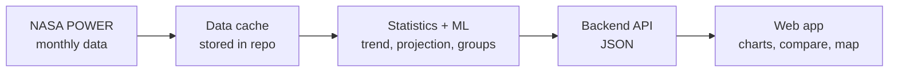

# SEATTLE-SCOPE

<p align="center">
  
</p>

<p align="center">
  <a href="https://seattle-scope.vercel.app"><b>Live app</b></a>
  &nbsp;·&nbsp;
  <a href="#how-it-works"><b>How it works</b></a>
  &nbsp;·&nbsp;
  <a href="#run-it-locally"><b>Run locally</b></a>
</p>

<p align="center">
  
  
  
  
</p>

---

## The question

Less rain should mean drier soil. Usually it does. But not always: in some places the rain holds steady while the soil slowly dries out, and in others the opposite happens.

**Seattle-Scope** is a web app for the *Be An Earth System Trend Detective* challenge. Pick a continent, pick a city, and see how **precipitation** and **root-zone soil moisture** have changed from **1981 to 2025**. Then let the app hunt for cities where the same variable moves in **opposite directions**.

> Where water goes, the Earth follows.

## At a glance

| | |
|:---:|:---|
| **39** | cities |
| **[6]** | continents |
| **45** | years of monthly data (1981 to 2025) |
| **21,060** | monthly records (39 cities x 540 months) |
| **2** | variables: precipitation and soil moisture |
| **4** | challenge questions answered: what, where, how much, is it significant |

## What you can do

- **Explore.** Choose a continent, then a city. Each city shows a tag for each variable: rising, falling, or no clear trend.
- **Read the trend.** For each variable you get an annual line, a faint monthly line, a dashed trend line, and an indicative 10-year projection band.
- **Get the numbers in plain words.** Change per decade (as a percent of the city's average), a 95% interval, the p-value, the number of years used, and one sentence such as "significant decrease".
- **Compare two cities.** If both trends are significant and point in opposite directions, an **OPPOSITE TRENDS** badge appears.
- **See the big picture.** A continent overview lists the strongest opposite-trend pairs and groups similar cities with K-Means.
- **Trust the result.** The app says "no clear trend" when there is none, and "n/a" where data does not exist (for example, soil moisture over ice). Demo data, if ever shown, carries a clear DEMO label.

<!--
SCREENSHOTS (optional). To show them: upload the PNG files to the repo root,
remove these comment markers, and keep the file names exactly the same.

<p align="center">
  
  
</p>
-->

## How it works



1. **Collect.** Monthly values for 39 cities are downloaded once from NASA POWER and saved in the repository, so the live app never waits for NASA.
2. **Clean.** Data is checked for missing or impossible values.
3. **Average.** Monthly values become annual averages. Years with fewer than 9 valid months are dropped.
4. **Test.** The **Mann-Kendall** test checks whether values tend to rise or fall more than chance allows (p < 0.05 means significant).
5. **Measure.** **Sen's slope** gives the size of the trend with a 95% confidence interval. It is robust to outliers.
6. **Project.** A scikit-learn linear model with an annual cycle gives an **indicative** projection for 2026 to 2035.
7. **Group.** **K-Means** clusters cities whose precipitation and soil moisture change in a similar way.

| Step | Method | Why |
|---|---|---|
| Trend test | Mann-Kendall | Standard in climate science, no assumption about the data's shape |
| Trend size | Sen's slope + 95% interval | Robust to outliers |
| Opposite trends | Both significant, opposite signs, largest gap first | The core idea of the challenge |
| Projection | Linear model with annual cycle | Shows where the trend leads if nothing changes |
| Grouping | K-Means | Big picture at a glance |

## Data

| Variable | NASA POWER parameter | Unit | Notes |
|---|---|---|---|
| Precipitation | `PRECTOTCORR` (corrected precipitation) | mm/day | Monthly average |
| Root-zone soil moisture | `GWETROOT` | 0 (dry) to 1 (saturated) | Top ~1 m of soil |

- **Source:** NASA POWER Monthly Point API, based on NASA GMAO MERRA-2
- **Period:** January 1981 to December 2025, monthly
- **Coverage:** 39 cities across [6] continents
- **Reanalysis, not a raw measurement.** MERRA-2 blends satellite and ground observations with a model.
- **Soil depth.** POWER's metadata mentions 200 cm, but NASA staff confirmed on the Earthdata forum that MERRA-2 uses 0 to 100 cm, so we write "top ~1 m".

## Run it locally

```bash
git clone https://github.com/madiha-creator/Seattle-Scope.git
cd Seattle-Scope
python -m venv venv
venv\Scripts\activate            # Mac/Linux: source venv/bin/activate
pip install -r requirements.txt
```

## Deploy on Vercel

Vercel serves the static frontend and bundled CSV data from `dist`. The deployed
app uses the cached data without a FastAPI backend; backend source remains
available for local development.


## API

Seven read-only endpoints: `meta`, `status`, `cities`, `trend`, `compare`, `opposites`, `clusters`. They are defined in `main.py`.


The frontend files and the NASA data cache are in the other folders of this repository.

## Limits

- Reanalysis data, not a direct measurement.
- The projection is **indicative only**. It is not a weather forecast and not an official NASA climate projection.
- Soil moisture is not available over ice, so Antarctica shows "n/a". That is expected.
- Finding "no clear trend" is a valid result, not an error.

## Team

· MADEHA SHAH

· AHMED SHAH

· HABIB UR REHMAN

· DUHA ABDULLAH

· MUHAMMAD ALI

## References

- NASA POWER: <https://power.larc.nasa.gov/>
- MERRA-2, NASA Global Modeling and Assimilation Office (Goddard Space Flight Center)
- NASA Earthdata forum: GWETROOT definition and soil depth note
- Mann, H. B. (1945) and Kendall, M. G. (1975): trend test. Sen, P. K. (1968): slope estimator.
- Open-source libraries: see `requirements.txt`


---

<p align="center">
  <sub>Built for the NASA Space Apps Challenge 2026. This project is not officially affiliated with NASA.</sub>
</p>

